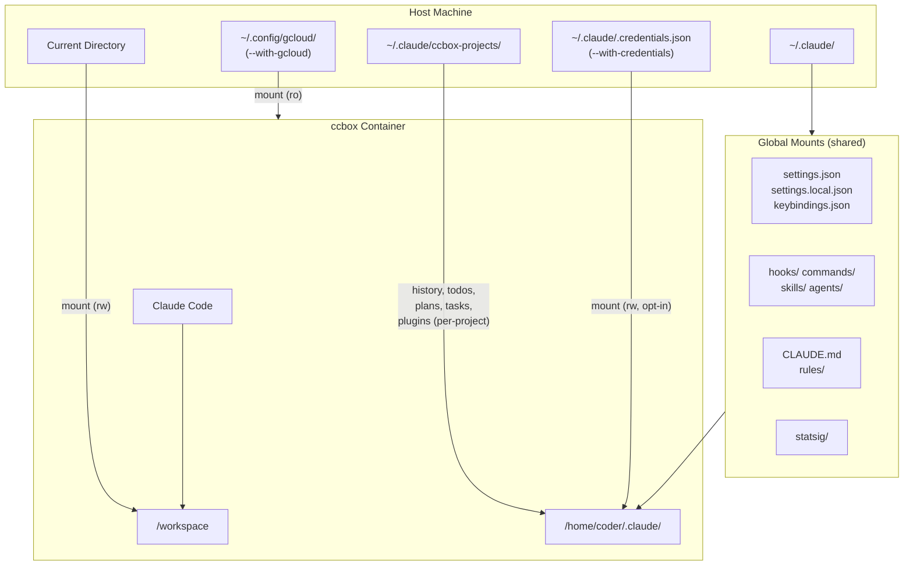

# Architecture

One repository produces five container images and five launchers from a shared base image, a harness Dockerfile and a launcher engine:

| Launcher | Harness | Image | Version pin file | Firewall overlay |
|----------|---------|-------|------------------|------------------|
| `ccbox` | [Claude Code](https://claude.com/product/claude-code) | `quay.io/guimou/ccbox` | `CLAUDE_VERSION` | `firewall-domains-claude.txt` |
| `ocbox` | [OpenCode](https://opencode.ai) | `quay.io/guimou/ocbox` | `OPENCODE_VERSION` | `firewall-domains-opencode.txt` |
| `qcbox` | [Qwen Code](https://github.com/QwenLM/qwen-code) | `quay.io/guimou/qcbox` | `QWENCODE_VERSION` | `firewall-domains-qwencode.txt` |
| `cxbox` | [Codex CLI](https://github.com/openai/codex) | `quay.io/guimou/cxbox` | `CODEX_VERSION` | `firewall-domains-codex.txt` |
| `ompbox` | [Oh My Pi](https://github.com/can1357/oh-my-pi) | `quay.io/guimou/ompbox` | `OMP_VERSION` | `firewall-domains-omp.txt` |

## Design Principles

- **Mount only the current folder** — the project directory is the only host code visible inside the container, at `/workspace`.
- **Per-project isolation** — each project gets its own history and session data; sessions of different projects never mix.
- **Share only what is truly shareable** — global settings and caches are shared across projects; credentials are opt-in (`--with-credentials`); everything stateful is per-project.
- **Host integration where it helps** — clipboard/display, audio, timezone, gcloud credentials (read-only, opt-in via `--with-gcloud`), host gitconfig (read-only, opt-in via `--with-gitconfig`), extra host directories (opt-in via `--mount`), harness credentials (read-write, opt-in via `--with-credentials`), GitHub token, and host-installed global npm packages (read-only) are connected from the host.
- **Rootless and SELinux-friendly** — Podman rootless with `--userns=keep-id`, `:z` volume labels on Linux.

## One Base, Five Images

The image is built in two stages, from two Dockerfiles:

**`Dockerfile.base` → `quay.io/guimou/codebox-base`.** All harness-independent layers: Fedora 44 base, OS packages, language runtimes, dev tools, Rust toolchain, firewall script, `coder` user and environment setup. It never references a harness. CI builds it once and tags it by content — the short SHA of the last commit touching its inputs (`Dockerfile.base`, `os-packages.txt`, `init-firewall.sh`) — plus `latest`. A harness-only change therefore never rebuilds the base, and a base change builds it exactly once for all five harnesses. Because the five images start from the *same* base tag, they always share an identical package set.

**`Dockerfile` → the five harness images.** Starts `FROM ${BASE_IMAGE}` and is parameterized by three build args:

- `BASE_IMAGE` — the base to build on (CI pins the content tag; the launcher passes a local `codebox-base:latest` or the published `latest`).
- `HARNESS` — `claude`, `opencode`, `qwencode`, `codex`, or `omp`; selects which single CLI is installed and which firewall overlay is baked in.
- `HARNESS_VERSION` — the harness version to install (empty means latest).

The harness stage is small and fast, and each harness build is independent of the others. It:

1. Concatenates `firewall-domains.txt` with `firewall-domains-${HARNESS}.txt` into `/etc/codebox/firewall-domains.txt`.
2. Installs exactly one harness CLI:
   - `claude` → native installer from claude.ai, built under a throwaway `HOME` and installed to `/usr/local/bin/claude` (not `/home/coder`), so the binary is reachable from any uid's PATH; a `~/.local/bin/claude` symlink keeps the workstation's usual PATH entry working
   - `opencode` → `npm install -g opencode-ai@<version>`
   - `qwencode` → `npm install -g @qwen-code/qwen-code@<version>`, plus a baked `/etc/qwen-code/settings.json` that disables auto-update and Qwen's own sandbox (to avoid sandbox-in-container nesting)
   - `codex` → `npm install -g @openai/codex@<version>` (npm wrapper that resolves to a per-platform native binary). Codex has no system-level config, so the `cxbox` launcher disables Codex's own sandbox (`sandbox_mode="danger-full-access"`, the container is the sandbox and bubblewrap/Landlock cannot nest in it) and the startup update check via `-c` overrides
   - `omp` → no npm: the prebuilt release binary (`omp-linux-{x64,arm64}`) is downloaded from GitHub Releases and checksum-verified against `SHA256SUMS.txt`. Oh My Pi's native addons (~340 MB) are extracted at build time (`omp config path`) into `/usr/local/lib/omp/natives` (not `~/.omp/natives`), readable by any uid and read-only beyond build time, via `PI_NATIVES_DIR`; the startup update check is disabled through a baked config overlay loaded via `PI_CONFIG_FILES`
3. Writes the harness's state-dir manifest, `/etc/codebox/sandbox-state-dirs` (one absolute path per line), and a common root block pre-creates each listed `/sandbox/...` dir at mode 0777 and installs `/etc/profile.d/zz-codebox-openshell.sh`. See "OpenShell runtime contract" below — this step only matters to the OpenShell sandbox launch path, not to the Podman/Apptainer launchers on this page.

Auto-updaters are disabled for all harnesses — versions are controlled by the pin files and image builds.

## One Engine, Five Launchers

The launchers are thin wrappers around a shared engine, `lib/box-common.sh`:

- Each wrapper defines **identity variables** (box name, harness, CLI binary, registry image, version flag/file, environment passthrough patterns).
- The engine provides everything common: argument parsing, image pull/build/tag resolution, project keying, container naming, base mounts (workspace, timezone, audio), opt-in host mounts (`--with-gcloud`, `--with-gitconfig`, `--mount`), clipboard wiring, npm-global mount, GitHub token injection, firewall capabilities, and the final `podman run`.
- Wrappers customize behavior through **hook functions** the engine calls at defined points: `harness_parse_arg` (harness-specific flags), `harness_ensure_config` (create global config on first run), `harness_setup_project` (create per-project host directories), `harness_mounts` (harness-specific volume mounts), `harness_pre_run` (wrap the launch command, e.g. tmux), and `harness_log_status`.
- Mounts and environment variables are declared in a **runtime-neutral form**: wrappers and the engine call `add_mount HOST CONTAINER [ro[,nolabel]]`, `add_optional_mount` and `add_env NAME VALUE`, which append to an ordered session spec. A **runtime backend** turns that spec, the image tag and the launch command into the actual command line. Two backends exist. The Podman backend adds the rootless flags (`--userns=keep-id`, `:z` labels unless `nolabel`, firewall capabilities) and runs `podman run`. The Apptainer backend (for a long-lived pod on Kubernetes, see [kubernetes.md](kubernetes.md)) converts the same registry image to a SIF on first use, runs `apptainer exec` with `--no-home --no-mount tmp,cwd --pid --ipc --cleanenv --writable-tmpfs` so that nothing from the pod is visible except the explicit binds, and passes the environment as `APPTAINERENV_*` exports. Both backends render the same session spec, so the wrappers and the isolation model are identical on a workstation and in a pod.

The wrappers locate the engine relative to their (symlink-resolved) location, supporting two layouts: a repo clone (`lib/box-common.sh` next to the launchers, used via symlinks) or a flat install (`box-common.sh` copied next to the launchers, e.g. in `~/.local/bin`). In a flat install there are no version pin files or Dockerfiles, so the image tag defaults to `latest` (overridable with the version flag) and `--build` / `--build-base` are unavailable.

## Container Runtime

- **Base**: `quay.io/guimou/codebox-base` (built from `quay.io/fedora/fedora:44`)
- **User**: `coder` (UID 1000) for `--userns=keep-id` compatibility
- **SELinux**: `:z` volume labels for shared relabeling (multi-session safe); omitted on macOS (virtiofs)
- **PID 1**: `--init` runs catatonit as PID 1 to reap orphaned processes; the harness does not reap them, so as PID 1 it would leave zombies holding slots of the container's pids limit until the container stops
- **Logging**: `--log-driver=none`, so the interactive session's terminal output (and anything shown in it) is not copied into the journal; `podman logs` is therefore empty for these containers
- **Container name**: `{box}-{project}-{hash}-{session-id}` — multiple sessions can run simultaneously in the same project, sharing project data
- **Firewall**: optional (`--with-firewall`), iptables/ipset allowlist, requires `NET_ADMIN`/`NET_RAW` (added automatically), Linux only
- **Memory budget**: every Podman session of every launcher joins one systemd user slice (`codebox.slice`, `--cgroup-parent`), generated from `CODEBOX_MEMORY_MAX` / `_HIGH` / `_SWAP_MAX` (defaults 80% of RAM / 90% of that / 2G), so all agents share one budget and are throttled and OOM-killed inside it rather than freezing the host; skipped with a warning when cgroup v2, a delegated user session or the systemd cgroup manager is missing (see [usage.md](usage.md#memory-budget))

> **Breaking change:** the container user and home folder were renamed from `claude` to `coder`. Images built before this change use `/home/claude`; rebuild or re-pull (`ccbox --build` / re-pull from the registry) so mounts line up with `/home/coder`. Host-side data is unaffected — `~/.claude/`, `~/.local/share/ocbox-projects/`, `~/.qwen/qcbox-projects/`, `~/.codex/`, and `~/.omp/` are unchanged; only the in-container home path moved.

## The Project Isolation Problem

Every project mounts at `/workspace` inside its container. Harnesses that key their internal state by project *path* (OpenCode, Qwen Code, Codex, Oh My Pi) would therefore collide: every project would look like the same project.

The launchers solve this **host-side**: each project gets its own host directory (keyed by `{sanitized-name}_{md5-hash-of-path}`) which is mounted *as* the harness's data/state directory inside the container. Shared items are file-mounted on top; the credential file is only shared when `--with-credentials` is passed.

## Per-Harness Mounts

Common to all launchers (handled by the engine): workspace, clipboard/display, PulseAudio, timezone, npm-global (ro), GitHub token env. Opt-in host mounts: `--with-gcloud` (gcloud, ro), `--with-gitconfig` (gitconfig, ro), `--mount HOST:CONTAINER[:ro]` (any host directory, repeatable), `--with-credentials` (the harness credential file, rw: `.credentials.json` for ccbox, `auth.json` for ocbox, `oauth_creds.json` for qcbox, `auth.json` for cxbox; ro for ompbox: `.env` and `agent/.env`).

### What credentials can reach the container

Three independent channels; only one is gated by a flag. A container is credential-free only if **all three** carry no key:

| Channel | Always or opt-in? | ccbox | ocbox | qcbox | cxbox | ompbox |
|---------|-------------------|-------|-------|-------|-------|--------|
| **Credential store file** (OAuth session / API key written by the harness) | **Opt-in** — only with `--with-credentials` | `~/.claude/.credentials.json` | `~/.local/share/opencode/auth.json` | `~/.qwen/oauth_creds.json` | `~/.codex/auth.json` | `~/.omp/.env` + `~/.omp/agent/.env` (ro); OAuth tokens live in the per-project `agent.db` instead and are never shared |
| **Main config** (the settings/config the harness needs to run; always mounted so the harness behaves correctly) | **Always** | `~/.claude/settings.json`, `settings.local.json`, `~/.claude.json` | whole `~/.config/opencode/` dir (incl. `opencode.json`) | `~/.qwen/settings.json` (+ home `~/.qwen/.env` ro if present) | `~/.codex/config.toml` (copied into the per-project dir at launch) | `~/.omp/agent/config.yml` (copied into the per-project dir at launch) |
| **Forwarded host env vars** (prefix match + a few specific vars; see `ENV_PASSTHROUGH_REGEX` in each wrapper) | **Always** | `ANTHROPIC_*`, `CLAUDE_CODE_*`, `CLAUDE_AX_*`, `CLAUDE_ENABLE_*`, `CLAUDE_AUTOCOMPACT_*`, `AWS_*`, `OTEL_*`, a few specific | `OPENCODE_*`, `ANTHROPIC_*`, `OPENAI_*`, `OPENROUTER_*`, `GEMINI_*`, `GOOGLE_*`, `AZURE_*`, `DEEPSEEK_*`, `MISTRAL_*`, `XAI_*`, `GROQ_*`, `AWS_*` | `QWEN_*`, `OPENAI_*`, `DASHSCOPE_*`, `BAILIAN_*`, `MODELSCOPE_*`, `OPENROUTER_*`, `ANTHROPIC_*`, `GEMINI_*`, `GOOGLE_*` | `CODEX_*`, `OPENAI_*`, `OPENROUTER_*`, `ANTHROPIC_*`, `GEMINI_*`, `GOOGLE_*`, `AZURE_*`, `DEEPSEEK_*`, `MISTRAL_*`, `XAI_*`, `GROQ_*`, `AWS_*` | `OMP_*`, `PI_*` (excluding the state-relocating vars), `ANTHROPIC_*`, `OPENAI_*`, `OPENROUTER_*`, `GEMINI_*`, `GOOGLE_*`, `AZURE_*`, `DEEPSEEK_*`, `MISTRAL_*`, `XAI_*`, `GROQ_*`, `QWEN_*`, `DASHSCOPE_*`, `COPILOT_*`, `AWS_*` |

The key point that surprises people: **`--with-credentials` does not control the main config or the env vars.** If an API key is stored in the always-mounted config (an `"env"` block, or a provider `apiKey`/`envKey`), or is exported on the host and matches a forwarded prefix, it reaches the container whether or not `--with-credentials` is passed. That is the intended trade-off for mounting the config unconditionally — the harness needs its config, and whatever is inside that config comes along. See [usage.md → API Provider Configuration](usage.md#api-provider-configuration) and [usage.md → Credentials](usage.md#credentials) for how to keep a key out (forwarded env var, or a project-local override file instead of the shared config).

How each harness *consumes* a key differs — ccbox reads standard env vars directly, ocbox uses the store file or the provider's declared env var (custom providers use `{env:VAR}` in config), qcbox resolves the env var named by `envKey` with priority shell > auto-loaded `.env` > settings `env` block, cxbox reads `OPENAI_API_KEY` directly or uses the ChatGPT OAuth session in `auth.json` (custom providers via `model_providers` in `config.toml`), and ompbox reads a provider's standard env var directly or a dotenv value from `~/.omp/.env` / `~/.omp/agent/.env`. Details in [usage.md](usage.md#how-each-harness-reads-the-key).

### ccbox (Claude Code)

| Location | Purpose | Scope |
|----------|---------|-------|
| **Settings** | | |
| `~/.claude/settings.json` | Global settings (or `settings-<name>.json` with `--settings <name>`) | Shared |
| `~/.claude/settings.local.json` | Local settings (not synced) | Shared |
| `~/.claude/keybindings.json` | Keyboard shortcuts | Shared |
| **Authentication** | | |
| `~/.claude/.credentials.json` | API credentials (opt-in, `--with-credentials`) | Shared (rw, not mounted by default) |
| `~/.claude.json` | Claude config | Shared |
| **Extensions** | | |
| `~/.claude/hooks/` | Custom hooks | Shared |
| `~/.claude/commands/` | Global slash commands | Shared |
| `~/.claude/skills/` | Global skills | Shared |
| `~/.claude/agents/` | Global subagents | Shared |
| `~/.claude/workflows/` | Saved workflow scripts | Shared |
| `~/.claude/daemon/` | Background agent daemon state | Per-container (not mounted) |
| **Memory & Rules** | | |
| `~/.claude/CLAUDE.md` | Global memory/instructions | Shared |
| `~/.claude/rules/` | Global rules | Shared |
| **Project Data** | | |
| `~/.claude/ccbox-projects/{name}_{hash}/` | History, todos, plans, tasks, plugins | Per-project |

The background agent daemon (`~/.claude/daemon/`) is deliberately **not** shared with the host: its lock file stores a PID, which is not valid across PID namespaces, so sharing it would let host and container daemons take over and kill each other. Each container runs its own isolated daemon instead. Consequence: background agents and sessions started inside ccbox die with the container and are not visible from the host (and vice versa).

### ocbox (OpenCode)

| Location | Purpose | Scope |
|----------|---------|-------|
| `~/.config/opencode/` | Global config, agents, commands, themes | Shared |
| `~/.local/share/opencode/auth.json` | Provider credentials (opt-in, `--with-credentials`) | Shared (rw, not mounted by default) |
| `~/.cache/opencode/` | Provider packages, LSP binaries | Shared |
| `~/.local/share/ocbox-projects/{name}_{hash}/data/` | Sessions, storage, logs (mounted as the container data dir) | Per-project |

The per-project host directory is mounted as the container's entire OpenCode data directory (`~/.local/share/opencode`); with `--with-credentials`, the shared `auth.json` is additionally file-mounted on top so credentials stay global. Without the flag the container uses its own empty credential file, so `opencode auth login` inside the container does not persist to the host.

### qcbox (Qwen Code)

| Location | Purpose | Scope |
|----------|---------|-------|
| `~/.qwen/settings.json` | User settings | Shared |
| `~/.qwen/oauth_creds.json` | Qwen OAuth credentials (opt-in, `--with-credentials`) | Shared (rw, not mounted by default) |
| `~/.qwen/QWEN.md` | Global memory file | Shared |
| `~/.qwen/qcbox-projects/{name}_{hash}/projects/` | Chat transcripts (session resume) | Per-project |
| `~/.qwen/qcbox-projects/{name}_{hash}/tmp/` | Shell history, checkpoints | Per-project |
| `~/.qwen/qcbox-projects/{name}_{hash}/file-history/` | File backups | Per-project |

An optional `~/.qwen/.env` is mounted read-only if present.

### cxbox (Codex CLI)

| Location | Purpose | Scope |
|----------|---------|-------|
| `~/.codex/config.toml` | Global config (model, providers, settings); copied into each per-project dir at launch | Shared (source of truth) |
| `~/.codex/auth.json` | API key / ChatGPT OAuth credentials (opt-in, `--with-credentials`) | Shared (rw, not mounted by default) |
| `~/.codex/cxbox-projects/{name}_{hash}/data/` | Sessions, state DB, memories, goals, and the `config.toml` copy (mounted as the container `~/.codex`) | Per-project |

Codex stores all state under `~/.codex` (`CODEX_HOME` is intentionally not forwarded into the container), keyed by project path. The per-project host directory is mounted as the container's entire `~/.codex`, so sessions, the state DB, and memories never mix across projects; the shared `config.toml` is **copied** into it at launch (seeded on first run, refreshed whenever the host file changed since the last launch, compared by content: an in-container save must not hide a host edit) rather than bind-mounted, because Codex saves config edits (project trust, `/model`, …) by renaming a temp file over `config.toml`, which fails on a single-file bind mount. Settings changed inside the container therefore stay per-project and are replaced the next time the host file changes; edit `~/.codex/config.toml` on the host for global changes. With `--with-credentials` the shared `auth.json` is mounted on top so credentials stay global (Codex rewrites it in place, so a file mount is fine there). Without the flag `codex login` inside the container writes `auth.json` into the per-project data dir, so it does not persist to the host file or to other projects.

### ompbox (Oh My Pi)

| Location | Purpose | Scope |
|----------|---------|-------|
| `~/.omp/agent/config.yml` | Global config (model, providers, settings); copied into each per-project dir at launch | Shared (source of truth) |
| `~/.omp/agent/{commands,rules,prompts,instructions,skills,hooks,tools,extensions}/` | Shareable config directories | Shared (rw, bind-mounted) |
| `~/.omp/agent/{SYSTEM.md,APPEND_SYSTEM.md,RULES.md,TITLE_SYSTEM.md,AGENTS.md,models.yml,mcp.json,keybindings.json}` | Shareable config files, when present on the host | Shared (ro, bind-mounted) |
| `~/.omp/.env`, `~/.omp/agent/.env` | Dotenv API keys (opt-in, `--with-credentials`) | Shared (ro, not mounted by default) |
| `~/.omp/ompbox-projects/{name}_{hash}/agent/` | `agent.db` (+ `-wal`/`-shm`), sessions, blobs, terminal sessions, history, and the `config.yml` copy (mounted as the container `~/.omp/agent`) | Per-project |
| `~/.omp/profiles/<name>/{config.yml,.env,models.yml}` | Account profiles (`ompbox --profile <name>`): config replaces the per-project config copy source (per-profile sync snapshot), `.env`/`models.yml` replace the corresponding shared mounts for that run | Shared (host files, per-launch selection) |

Oh My Pi keeps three kinds of state, each with a different constraint on how it can be mounted:

- **`agent.db`** is a SQLite database in WAL mode holding OAuth tokens, `/login`-saved API keys, settings, usage stats, model performance data, and the memory store — the memory store is keyed by working directory, which inside the container is always `/workspace`. Sharing it across projects would therefore mix every project's memories together, so it stays strictly per-project and is never bind-mounted as a single file (WAL mode also makes a single-file mount unsafe: the `-wal`/`-shm` companions need to live alongside it on the same filesystem).
- **`config.yml`** is saved by omp via write-temp-then-rename, the same pattern Codex uses for `config.toml`, so it cannot be a single-file bind mount (rename over a bind-mounted file fails with `EBUSY`). It is copied into the per-project dir at launch instead — seeded on first run, refreshed whenever the host file changed since the last launch — exactly like cxbox's `config.toml`.
- **Shared config directories and files** under `~/.omp/agent/` (commands, rules, prompts, instructions, skills, hooks, tools, extensions, plus the user-authored prompt/config files above) are ordinary files or directories that omp does not rewrite in place, so they are bind-mounted directly from the host: the directories read-write, the files read-only, and only when they exist on the host.

- **Account profiles** (`--profile <name>`, see [usage.md](usage.md#account-profiles-ompbox)) are a host-side config/credentials overlay, not state: the profile's `config.yml` becomes the source for the per-project copy (each source tracks its own sync snapshot, so switching profiles replaces the in-container copy on the next launch with that profile), its `.env` and `models.yml`, when present, replace the shared `agent/.env` and `models.yml` mounts for that run. `agent.db`, sessions, and memories stay per-project regardless of profile.

`--with-credentials` mounts the two dotenv files read-only; it does not and cannot share `agent.db`, so `/login` (browser OAuth, or headless by pasting the callback URL) always stays local to the project it was run in.
## Firewall

When launched with `--with-firewall` (Linux only), outbound connections are restricted to an allowlist baked into each image at build time from two files:

- `firewall-domains.txt` — common to all harnesses: GitHub (`github.com`, `api.github.com`, `objects.githubusercontent.com`, plus their IP ranges), npm registry, Python packages (`pypi.org`, `files.pythonhosted.org`), Rust packages (`crates.io`, `static.crates.io`)
- `firewall-domains-{claude,opencode,qwencode,codex,omp}.txt` — harness-specific:
  - **claude**: `api.anthropic.com`, `statsig.anthropic.com`, `claude.ai`, `code.claude.com`, `sentry.io`
  - **opencode**: `opencode.ai`, `api.opencode.ai`, `models.dev`, plus common provider endpoints
  - **qwencode**: `chat.qwen.ai`, `portal.qwen.ai`, DashScope endpoints, plus common provider endpoints
  - **codex**: `api.openai.com`, `auth.openai.com`, `chatgpt.com`, plus common provider endpoints
  - **omp**: `omp.sh` (install/update scripts), `my.omp.sh` (opt-in `/collab` relay), plus common provider endpoints (`api.anthropic.com`, `api.openai.com`, `auth.openai.com`, `chatgpt.com`, `generativelanguage.googleapis.com`, `openrouter.ai`, `api.groq.com`, `api.mistral.ai`, `api.x.ai`, `api.deepseek.com`)

`init-firewall.sh` resolves the allowlist into an ipset at container start and installs default-deny iptables rules.

**Limitations:** Web search, web fetch, and HTTP-based MCP servers will **not** work with the firewall enabled, as they require access to arbitrary domains. Only stdio MCP servers (local processes) function behind the firewall.

## OpenShell Runtime Contract

The five images are also run outside the launchers, as OpenShell sandboxes on Kubernetes (the [agents-jukebox](https://github.com/rh-aiservices-bu/agents-jukebox) console). That launch path mounts only the repo (at `/sandbox/repos`) and runs the harness as an arbitrary, non-`coder` sandbox uid, so none of the `/home/coder` mounts above apply. The image carries everything that path needs on its own:

- **No gid 0.** The sandbox uid is non-root with no supplemental groups and no gid 0, so the OpenShift "`chgrp 0` / `g=u`" pattern does not work for sharing a directory. Every state dir the harness needs is instead pre-created in the image at **mode 0777** (not 1777 — the sticky bit only matters when other uids share a dir, and it is risky for a harness that saves by renaming over existing files).
- **The state-dir manifest.** Each harness's root `case` arm in the `Dockerfile` writes its own list of absolute paths, one per line, to `/etc/codebox/sandbox-state-dirs`. A common block after the `case` creates `/sandbox` itself (root, 0755 — it stays unwritable to the sandbox uid, since only the listed dirs underneath it are 0777) and then every dir named in the manifest. This manifest is the source of truth for the per-image state dirs that the console's sandbox-creation policy must grant `readWrite`; the two lists must match exactly, because the sandbox's Landlock policy silently drops any `readWrite` path that does not already exist when the sandbox starts — it does not create missing paths.
- **`/etc/profile.d`, not image `ENV`.** A sandbox exec session clears the environment and only reconstructs a short allowlist; image-level `ENV` values are not among them. Only the sandbox's login shell sources `/etc/profile.d/*.sh`, so that is the delivery path for per-image defaults. `/etc/profile.d/zz-codebox-openshell.sh` sets `DISABLE_AUTOUPDATER`, `OPENCODE_DISABLE_AUTOUPDATE`, `PI_CONFIG_FILES`, `PI_NATIVES_DIR` and `CLAUDE_CONFIG_DIR` with `:=` (only if unset), guarded by `OPENSHELL_SANDBOX` so it is a no-op everywhere else, including on the workstation launchers on this page. Because it is `:=`, the sandbox-creation spec's own env always wins when it sets the same name.
- **No `/home` at runtime.** Binaries and natives that the sandbox uid must read are under `/usr/local` (`/usr/local/bin/claude`, `/usr/local/lib/omp/natives`), not `/home/coder`: the sandbox has no writable `/home`, and a read-only system path works for both the sandbox and the workstation launchers (which keep working through a `~/.local/bin/claude` symlink and the `PI_NATIVES_DIR` env var).

This is a one-way bridge: the image's `/sandbox/<state dir>` contents and `/usr/local` binaries exist so the *current* sandbox launch path (no mount at `/sandbox` itself) works without a dedicated per-sandbox volume. A future agent volume mounted at `/sandbox` would hide everything the image baked in there — at that point the mount itself grants read-write access and the image dirs stop being needed for that purpose, but the `/usr/local` relocations and the `profile.d` env stay.
